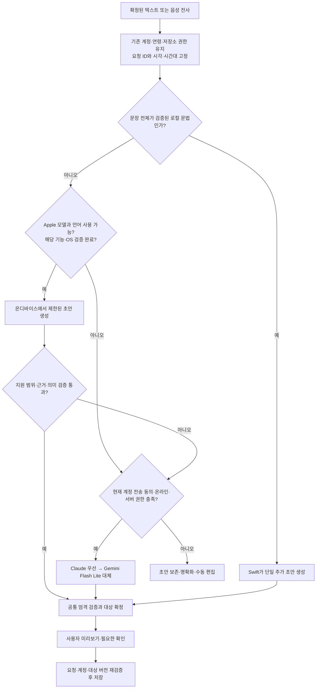

<callout icon="📌" color="blue_bg">
	**AI·온디바이스 설계 정본 — 2026-10-22**
	사용자 요청에 따라 이번 조사 결과를 정본으로 지정했다. 이전 MORA 문서와 충돌하면 **AI 제공자 선택, 온디바이스 적용 범위, 별도 설정 없는 UX, 모델 평가 결과 및 도입 조건**에 한해 이 페이지가 우선한다.
	이 페이지는 **채택할 설계와 조사 근거**이며 새 로컬·Apple 경로의 구현/배포 완료를 뜻하지 않는다. 계정 격리·연령·기존 유료 권한·보안 수용 기준은 유지한다. 실제 운영 배포 상태는 별도 확인 대상이다.
</callout>
상위 문서: <mention-page url="https://app.notion.com/p/3928320bd64b80cf883df0af9ad0187b"/> · 기존 전체 명세: <mention-page url="https://app.notion.com/p/2edbd8b75826480ea2cd41655b9a7ef3"/> · 보안 SDD: <mention-page url="https://app.notion.com/p/3af8320bd64b81788d14d50c9cfc2379"/>

<table_of_contents/>

작성: <mention-date start="2026-10-22"/> · 대상: iPhone 네이티브 SwiftUI 앱, 최소 iOS 26.2

## 결정

**설정 없는 자동 하이브리드를 선택한다.** 명확한 단일 추가는 Swift 로컬 파서가 처리하고, Apple의 온디바이스 모델이 **이미 사용 가능하며 MORA 평가를 통과한 기능**에 한해 자동으로 활용한다. 나머지는 기존 **Claude 우선 → Gemini Flash Lite 대체** 경로로 처리한다. 사용자가 모델을 고르거나, API 키를 입력하거나, Apple Intelligence를 켜러 설정으로 이동하게 만들지 않는다.

**0.5~1.1GB의 공개 생성 모델을 출시 앱에 기본 포함하지 않는다.** 이번에 직접 실행한 두 후보는 유효한 JSON을 만들면서도 정정·부정·삭제 예외를 틀렸다. 비용과 설치 크기를 늘릴 만큼의 정확성 근거가 없다. Jev, GLiNER, 임베딩 분류기를 추가하는 것도 현재는 보류한다.

이 선택은 **모든 iPhone에서 모든 자연어 명령이 완전히 오프라인으로 작동한다는 뜻은 아니다.** Apple 모델이 꺼져 있거나 지원되지 않는 기기에서는 추가 설정을 요구하지 않고 클라우드로 이어진다. 네트워크나 전송 동의가 없으면 로컬에서 확실히 처리할 수 있는 범위만 제공하고, 나머지는 초안을 유지한다.

현재 출시 준비 상태에서는 기존 클라우드 경로를 유지한다. 아래의 검증기를 먼저 보강하고, 로컬 파서와 Apple 경로를 각각 검증한 뒤 활성화하는 순서로 확정한다. 이번 조사에서 앱의 운영 라우팅을 변경하거나 온디바이스 기능을 배포하지 않았다.

## 판단 기준과 실제 조사

우선순위는 ① 의도와 다른 일정 변경 방지 ② 별도 AI 설정 없는 사용 ③ 한국어·영어·일본어 처리 ④ 기존 지원 기기에서의 안정성 ⑤ 설치 크기와 비용이다. “가장 작은 모델”이나 “가장 많은 로컬 처리”만으로 최적을 정의하지 않았다.

세 적대적 서브에이전트가 각각 구조, 모델·런타임·배포, 의미 정확성·개인정보 경계를 조사했다. 후보를 반박하는 역할을 맡겼고, 이후 실험 방법과 최종 결론을 다시 공격하게 했다. 세 에이전트의 동의 자체를 품질 증거로 삼지 않고, 실제 코드·공식 자료·재현 가능한 실행 결과를 근거로 삼았다.

수행한 일:

- 현재 앱의 분석 진입점, 함수 스키마, 검증기, 대상 선택, 확인 UI, 음성 인식 경로를 읽었다.
- 공식 문서와 고정 버전 소스로 Apple Foundation Models, llama.cpp, MLX Swift, Qwen, LFM, GLiNER·분류기 대안을 비교했다.
- 고정 버전 llama.cpp와 해시를 검증한 공개 모델 2개로 **수정된 공통 프롬프트 각각 30건, 총 60건**의 합성 입력을 실제 실행했다.
- 별도로 초기 프롬프트 진단 14건을 수행했다. 그중 스키마 설명이 불완전했던 12건은 최종 비교에서 제외하고 원본을 보존했다.
- 실제 서버의 `validateAnalysisCalls`를 그대로 가져와 모델 출력의 형식·필드 유효성을 검사했다. 별도 에이전트가 의미를 독립 판정했다.
- 호스트의 Apple 시스템 모델 가용성을 Swift로 확인했다. **available**, KO/EN/JA locale 지원 모두 true였다. 설정을 바꾸거나 다운로드를 요청하지 않았으며 Apple 모델 추론은 실행하지 않았다.

실험 호스트는 macOS 26.3.1(a), arm64, RAM 8GiB다. Xcode 26.6 / Swift 6.3.3 / iOS SDK 26.5가 설치되어 있다. 확인 당시 등록된 iPhone 14와 iPad는 연결 불가 상태여서 **실물 iPhone의 지연·메모리·발열·배터리는 측정하지 못했다.**

## 실제 모델 실행 결과

공통 조건: llama.cpp v0.7.0의 b11669 바이너리, Metal, 한 번에 모델 하나, context 8,192, 최대 출력 512 tokens, thinking off, temperature 0, seed 42. 모든 평가 입력은 합성 문장이며 실제 계정·일정 데이터나 유료 API를 사용하지 않았다. 생성된 명령을 실행하거나 알림을 등록하지 않았다.

기본 사례는 4가지 패턴을 KO/EN/JA로 표현한 12건이다. 적대적 사례 18건은 정정, 부정, 삭제 예외, 시간 제거, 반복 예외, 잘못된 날짜, 시간대 등을 포함한다. 계정 전환과 오프라인 동의 처리 2건은 별도 통합 검증 항목이며 모델 점수에서 제외했다.

<table header-row="true">
	<tr>
		<td>비교 항목</td>
		<td>Qwen3.5-0.8B Q4_0</td>
		<td>Qwen3-1.7B Q4_K_M</td>
	</tr>
	<tr>
		<td>검증한 모델 파일 크기</td>
		<td>563,036,064 bytes</td>
		<td>1,107,409,472 bytes</td>
	</tr>
	<tr>
		<td>JSON 파싱 성공</td>
		<td>30/30</td>
		<td>30/30</td>
	</tr>
	<tr>
		<td>현재 서버 필드 검증 통과</td>
		<td>24/30</td>
		<td>29/30</td>
	</tr>
	<tr>
		<td>기본 사례 의미 정확</td>
		<td>6/12</td>
		<td>9/12</td>
	</tr>
	<tr>
		<td>적대적 사례 의미 정확</td>
		<td>0/18</td>
		<td>3/18</td>
	</tr>
	<tr>
		<td>적대적 사례 안전한 보류</td>
		<td>1/18</td>
		<td>2/18</td>
	</tr>
	<tr>
		<td>적대적 사례 의미 오류</td>
		<td>17/18</td>
		<td>13/18</td>
	</tr>
</table>

**형식 검증 성공률이 높아져도 의미 오류가 해결되지 않았다.** 1.7B의 의미 오류 중에는 잘못된 요일을 되묻는 비변경 결과 1건도 포함된다. 모든 의미 오류를 실제 데이터 손상으로 세지 않았다. 모델이 변경을 제안한 오류 15건 중 14건은 현재 서버의 필드 검증도 통과했다.

실제 반례:

<table header-row="true">
	<tr>
		<td>입력</td>
		<td>관찰한 출력</td>
		<td>문제</td>
	</tr>
	<tr>
		<td>“내일 오후 3시 치과, 아니 4시로 잡아줘.”</td>
		<td>두 모델 모두 오후 3시 추가</td>
		<td>최종 정정을 놓침</td>
	</tr>
	<tr>
		<td>“내일 일정 다 지워, 치과만 빼고.”</td>
		<td>1.7B: 내일 일정 전체 삭제</td>
		<td>보존해야 할 예외를 버림</td>
	</tr>
	<tr>
		<td>“洗濯はまだ終わっていない。完了を取り消して。”</td>
		<td>두 모델 모두 세탁 완료 처리</td>
		<td>완료 취소를 반대로 해석</td>
	</tr>
	<tr>
		<td>오전 10시 기준 “한 시간 뒤에 팀 미팅 추가해줘”</td>
		<td>1.7B: 오후 1시</td>
		<td>상대 시간 계산 오류</td>
	</tr>
	<tr>
		<td>“Move tomorrow's Dentist to Friday at 3 PM.”</td>
		<td>1.7B: 모든 일정을 다른 날짜로 미룸</td>
		<td>특정 일정 변경을 전체 변경으로 확대</td>
	</tr>
</table>

0.8B의 초기 운영 프롬프트 진단에서는 “내일 오후 3시 치과”가 오늘 오전 10시로 나왔다. 짧은 프롬프트를 처음 만들 때 JSON Schema를 출력 제약으로만 전달하고 모델에 충분히 설명하지 않은 실험 결함도 적대적 검토가 발견했다. 이를 수정해 **필드 스키마·단발 작업 규칙·세 언어 예시를 명시한 뒤** 위 표의 60건을 실행했다. [llama.cpp도 스키마 제약이 자동으로 프롬프트에 주입되는 것은 아니라고 설명한다.](https://github.com/ggml-org/llama.cpp/blob/v0.7.0/grammars/README.md#json-schemas--gbnf)

해석의 한계:

- 이것은 개발용 소규모 진단이다. 운영 정확도나 일반적인 모델 우열의 추정치가 아니다. 일부 기본 사례는 프롬프트 예시와 유사하고 C11은 예시와 동일하다.
- temperature 0은 제한된 재현 진단 조건이며 제조사의 권장 샘플링과 다르다. 최적 튜닝·미세조정 후의 성능을 평가한 것이 아니다. [Qwen3.5 모델 카드](https://huggingface.co/Qwen/Qwen3.5-0.8B), [Qwen3 모델 카드](https://huggingface.co/Qwen/Qwen3-1.7B)
- 두 모델은 세대·크기·양자화가 다르다. 이 비교로 파라미터 수의 효과나 MLX 대비 llama.cpp 우열을 분리할 수 없다.
- 모든 최종 출력은 정상 종료했다. 이번 실패는 512-token 잘림 때문에 생긴 결과가 아니다. 실제 앱의 최대 50개 명령 지원은 별도로 평가해야 한다.
- Mac 처리 시간은 원본 로그에만 보존했다. 캐시 재사용도 있어 iPhone 속도로 인용하지 않는다. 모델 파일 크기는 peak RAM이나 App Store 다운로드 크기가 아니다.

## 후보를 탈락시키거나 순서를 바꾼 이유

<table header-row="true">
	<tr>
		<td>후보</td>
		<td>판단</td>
	</tr>
	<tr>
		<td>**Swift 규칙·Calendar 처리**</td>
		<td>명확한 단일 추가를 처리할 첫 로컬 경로. 모델 파일이 필요 없다. 문장 일부의 키워드만 잡는 방식은 불허한다. 실제 자연스러운 입력의 처리 범위는 아직 미측정이다.</td>
	</tr>
	<tr>
		<td>**이미 사용 가능한 Apple SystemLanguageModel**</td>
		<td>큰 모델을 번들하기 전에 검증할 우선 후보. 가용성과 언어 지원을 확인해 자동 선택하면 사용자가 설정을 바꿀 필요가 없다. 모든 기기의 공통 기본 엔진으로는 사용할 수 없다.</td>
	</tr>
	<tr>
		<td>**llama.cpp + Qwen 번들**</td>
		<td>별도 앱 없이 iPhone 프로세스 안에 포함할 수 있다. 하지만 실행한 두 구성의 의미 정확성은 부족했다. Apple 비지원 기기에서도 폭넓은 완전 오프라인 처리가 필수가 될 때 다시 검토한다.</td>
	</tr>
	<tr>
		<td>**MLX Swift + 번들 모델**</td>
		<td>실제 iOS 지원과 구조화 생성 기능이 있다. Swift 연동상 장점은 있으나 이번에 더 빠르거나 정확하다고 측정하지 않았다. 지금 런타임까지 바꾸면 추가 변수가 생기므로 기존 llama 실험을 유지한다.</td>
	</tr>
	<tr>
		<td>**Core ML/ONNX 분류기·GLiNER·SetFit·임베딩**</td>
		<td>의도 분류·추출의 도구다. 달력 의미, 부정 범위, 예외, 대상 식별을 완성해 주지 않는다. MORA 라벨 데이터와 변환·검증 없이 기본 엔진으로 채택하지 않는다.</td>
	</tr>
	<tr>
		<td>**LFM2.5 / d1 계열**</td>
		<td>LFM2.5는 언어·추출 측면에서 연구 가치가 있지만 별도 상업 라이선스 조건이 있다. 자격을 확인하지 않은 상태에서 기본 의존성으로 선택하지 않았다. d1 선택형 출력만으로 자유로운 작업 제목·날짜 추출을 대체할 수 없다.</td>
	</tr>
</table>

대안의 근거는 [GLiNER2 공식 저장소](https://github.com/fastino-ai/GLiNER2), [SetFit 공식 문서](https://huggingface.co/docs/setfit/main/index), [LFM2.5 모델 카드](https://huggingface.co/LiquidAI/LFM2.5-1.2B-Instruct), [해당 가중치 라이선스](https://huggingface.co/LiquidAI/LFM2.5-1.2B-Instruct-GGUF/blob/8ed288026e23958ad9dfa92d53ed773a8eee7125/LICENSE), [d1-omni 공식 설명](https://huggingface.co/LiquidAI/d1-omni-600M)을 확인했다.

Apple에 대한 초기 탈락 판단을 수정했다. **“Apple Intelligence가 모든 기기에서 준비되어 있지는 않다”는 사실은 “준비된 기기에서만 자동 사용”하는 설계의 탈락 사유가 아니다.** 자동 클라우드 대체가 허용되는 이번 제품에서는 후자가 유효하다. 다만 가용성 확인만으로 의미 정확성은 입증되지 않는다. [Apple 가용성 안내](https://developer.apple.com/documentation/FoundationModels/generating-content-and-performing-tasks-with-foundation-models), [언어·OS별 확인 방법](https://developer.apple.com/documentation/foundationmodels/supporting-languages-and-locales-with-foundation-models)

llama.cpp의 [공식 iPhone 예제](https://github.com/ggml-org/llama.cpp/blob/v0.7.0/examples/llama.swiftui/README.md)는 XCFramework 내장을 지원한다. 연구에서는 localhost 서버를 썼지만 제품에는 HTTP 서버를 넣는 설계를 선택하지 않는다. MLX의 [고정 버전 패키지](https://github.com/ml-explore/mlx-swift-lm/blob/3.32.3/Package.swift)와 [구조화 생성 모듈](https://github.com/ml-explore/mlx-swift-lm/blob/3.32.3/Libraries/MLXGuidedGeneration/README.md)도 확인했다. 직접 MLXLLM 경로와 iOS 27용 FoundationModels 연결 기능은 구분해야 한다. 앱의 Swift 5 언어 모드는 설치된 Swift 컴파일러가 5라는 뜻이 아니다.

## 선택한 구조



이는 구현할 구조이며 현재 활성화된 동작을 그린 그림이 아니다. 특히 Apple 경로는 평가 전에는 꺼 둔다. 모델의 자체 confidence나 “JSON이 유효하다”만으로 분기하거나 저장하지 않는다. 오류·timeout 때만 fallback하는 설계는 위의 의미 오류를 잡지 못한다.

로컬 파서는 **명확한 단일 추가**부터 시작한다. 문장 전체를 소비하고, 일정 제목·시간 표현의 원문 위치를 보존한다. 부정·정정·예외·인용·복합 지시를 일부만 해석하지 않는다. 상대 날짜·시간은 모델이 최종 숫자를 계산하게 두기보다 원문에서 검증한 시간 표현을 Swift `Calendar`로 계산한다. 표현할 수 없는 반복·시간대·대상 조건은 조용히 버리지 않고 명확화한다.

로컬 처리는 현재 수동 QuickAdd와 같은 권한·연령·계정 소유 저장소 조건을 따른다. 로그인이나 연령 제한 전체를 우회하지 않는다. **네트워크, 클라우드 전송 동의, 클라우드 분석 quota처럼 원격 처리에만 필요한 조건**을 클라우드 분기로 옮기는 것이다. 로컬 성공은 서버 AI 횟수를 차감하지 않으며 기존 유료 기능 권한은 유지한다. 실제 상품 정책 변경은 별도 변경점으로 기록해야 한다.

동의 없는 입력을 연결이 복구됐다는 이유로 나중에 자동 업로드하지 않는다. A→B→A 계정 전환·사용자 취소·오래된 결과는 모두 폐기한다. 로컬 모델의 세션과 캐시에도 같은 경계를 적용한다.

## 현재 코드에서 먼저 해결할 부분

아래는 로컬 분석기를 연결할 때 필요한 구조 변경이다. 이번 조사에서 이 소스들을 수정하지 않았다. 코드 읽기로 확인한 사항이며 새 보안 취약점의 악용을 입증한 보고서는 아니다.

<table header-row="true">
	<tr>
		<td>근거</td>
		<td>필요한 변경</td>
		<td>근거 확실성</td>
	</tr>
	<tr>
		<td>HomeVoiceInterfaceView.swift:606 (`ADHD/HomeVoiceInterfaceView.swift:606`)</td>
		<td>분석 전에 걸린 원격 전용 조건을 분리하고, 로컬·클라우드가 공통 확인/실행 경로로 합류하게 한다.</td>
		<td>9/10</td>
	</tr>
	<tr>
		<td>LLMFunctionCall.swift:134 (`ADHD/Functions/LLMFunctionCall.swift:134`)</td>
		<td>잘못된 category를 Routine으로 보정하지 않고 거부한다.</td>
		<td>9/10</td>
	</tr>
	<tr>
		<td>LLMFunctionCall.swift:295 (`ADHD/Functions/LLMFunctionCall.swift:295`), 서버 validator (`supabase/functions/analyze-task/validator.ts`)</td>
		<td>Swift에도 time·실제 날짜·enum·길이·키·개수의 엄격한 검증을 둔다. 로컬 모델 결과는 서버 검증을 거치지 않는다.</td>
		<td>9/10</td>
	</tr>
	<tr>
		<td>TaskManager+LLM.swift:231 (`ADHD/Functions/TaskManager+LLM.swift:231`)</td>
		<td>이름/부분 문자열의 첫 작업 선택 대신 복수 후보를 명확화하고 UUID·버전에 고정한다.</td>
		<td>9/10</td>
	</tr>
	<tr>
		<td>파라미터 정의 (`ADHD/Functions/LLMFunctionCall.swift:68`)</td>
		<td>시간 제거와 변경 없음, 완료 취소, 반복 예외 등 표현 불가능한 의미를 모델이 임의 변환하지 않도록 한다. 확장은 후속 범위로 둔다.</td>
		<td>9/10</td>
	</tr>
	<tr>
		<td>확인 및 실행 흐름 (`ADHD/HomeVoiceInterfaceView.swift:729`)</td>
		<td>새 생성 엔진의 초기는 미리보기를 필수로 한다. 삭제·전체 변경 및 대상 불확실성에 대한 기존 보호를 유지한다.</td>
		<td>8/10</td>
	</tr>
</table>

재사용할 기존 구조는 `PendingLLMCall`, prepared target snapshot, stale 검사, 취소·활성 요청 ID, 계정 scope, 확인 카드, 저장 결과 처리다. `CloudLLMManager` 자체를 로컬 분석기의 부모로 쓰면 서버·quota 의존성을 끌고 오므로, 상위 분석 인터페이스에서 병렬 구현으로 분리하는 편이 맞다.

**음성 전사는 별도 경계다.** 현재 VoiceInputManager.swift:322 (`ADHD/VoiceInputManager.swift:322`)는 `requiresOnDeviceRecognition`을 지정하지 않는다. 텍스트 해석을 로컬로 옮겼다고 “음성이 기기 밖으로 나가지 않는다”고 안내해서는 안 된다. 지원 여부를 확인해 로컬 음성 인식을 요청하고, 지원되지 않으면 텍스트 입력 또는 명확히 고지된 기존 음성 경로를 제공해야 한다. [Apple의 로컬 인식 조건](https://developer.apple.com/documentation/speech/sfspeechrecognitionrequest/requiresondevicerecognition)

## 도입 순서와 통과 기준

1. **공통 실행 경계 보강.** 엄격한 Swift 검증, 대상 중복 명확화, 시간 문맥 고정, 취소·계정 전환 검사를 먼저 구현한다. 기존 클라우드에도 이익이 있다.
2. **단일 추가의 로컬 경로.** 외부 모델 없이 처리할 수 있는 문법을 넣고 동일한 적대적 사례로 검증한다. regex로 단어가 발견됐다는 이유만으로 실행하지 않는다.
3. **Apple의 제한된 자동 경로 검증.** 기기·OS·언어별 가용성을 확인하고, 동일한 의미 평가·실기기 검증을 통과한 기능만 활성화한다. 사용자에게 활성화나 모델 준비를 요구하지 않는다.
4. **범위 확대는 수치로 결정.** 규칙의 유용한 처리율이 낮거나 Apple 비지원 기기의 광범위 오프라인 요구가 커졌을 때만 번들 모델·도메인 학습을 다시 비교한다.

출시 gate는 구현 전에 다음처럼 고정하는 것을 권고한다. 아래 수치는 **제품 목표 제안이며 측정 결과가 아니다.**

- 별도 held-out KO/EN/JA corpus를 만든다. 사람들이 문법을 배우지 않고 말한 입력·음성 오인식·정정·인용·경계 날짜를 포함한다. 적대적 사례에서 의도하지 않은 변경을 수락한 관측 사례는 0건이어야 한다. 작은 표본의 0건을 위험 0%로 해석하지 않는다.
- 허용된 결과의 전체 의미 정확도와 처리 범위를 함께 보고한다. 지원 스키마로 표현 가능한 **모든 입력**을 분모로 삼아 언어별 유용한 로컬 처리율 70%를 목표로 한다. 이보다 낮으면 제한적인 로컬 빠른 경로로 설명하고 일반 자연어 온디바이스 기능이라고 홍보하지 않는다.
- 4GB/6GB 지원 iPhone의 Release 빌드에서 fresh install, 비행기 모드, Apple 모델 unavailable, cold/warm 완료 시간, peak 메모리, 음성 동시 사용, background/foreground, 취소, 반복 사용 발열을 측정한다. warm 완료 p95 2초·cold p95 5초를 초기 UX 목표로 두고, 도달 여부를 측정한다. 구체적 메모리 예산은 실제 기본 앱 peak와 기기별 여유를 측정해 정한다.
- 네트워크/동의/한도 실패 때 초안 유지, 무단 전송 0건, 계정 전환 후 늦은 저장 0건을 통합 검증한다. AI 엔진 선택은 사용자에게 새 단계로 노출하지 않는다.
- 모델이 최종 날짜와 실행 명령을 직접 생성하는 방식뿐 아니라, **제한된 의미 추출 → 결정론적 날짜·대상 처리** 방식도 비교한다. 이번 직접 JSON 실험만으로 이 대안의 가능성까지 배제하지 않는다.

필수 테스트 경로:

```text
확정 입력
├─ 로컬 문법 일치 → 단일 추가 → 검증 → 확인 → 저장 [unit + E2E]
├─ 부정/정정/예외/남은 미해석 구문 → 보류/fallback [semantic eval]
├─ Apple 사용 가능 + 언어/기능 허용 → 초안 [semantic eval + iPhone]
├─ Apple unavailable/unsupported → 다음 허가된 경로 [unit + E2E]
├─ 사용자 취소/계정 무효화 → 요청 종료·업로드/변경 금지 [unit + E2E]
├─ cloud 동의/온라인/권한 충족 → 기존 Claude→Gemini [회귀 + E2E]
└─ cloud 불가 → 입력 유지·명확화·수동 편집 [E2E]
공통 실행
├─ 잘못된 날짜/시각/반복/키 → 거부 [unit]
├─ 동명 후보·stale target → 재선택/재확인 [unit + E2E]
├─ A→B→A·취소·중복 제출 → 이전 결과/중복 저장 방지 [E2E]
└─ 저장 실패/부분 성공 → 결과를 정확히 표시 [기존 회귀 + E2E]
```

이 테스트들은 도입 시 통과해야 하는 계획이다. 이번에 Swift 앱의 이 새 경로를 구현하거나 E2E 통과를 주장하지 않는다. 병렬 작업은 공통 계약 확정 후 ① Swift 검증·실행 경계 ② 로컬 분석기와 Apple adapter ③ 언어별 평가·실기기 QA로 나눌 수 있다.

## 적대적 검토가 남긴 반론과 결론을 뒤집는 조건

- **규칙의 처리율이 낮으면 온디바이스라는 이름만 남는다.** 실제 입력에서 유용한 범위를 입증하지 못하면 기본 기능이라는 표현을 철회한다. 규칙도 모델과 동일한 평가를 받아야 한다.
- **Apple 자동 경로도 의미 오류를 낼 수 있다.** available/locale 확인만으로 켜지 않는다. 별도 검증과 제한된 허용 기능이 필요하다. OS 모델 변경 시 핵심 회귀 평가를 다시 수행한다.
- **두 작은 모델의 실패는 모든 작은 모델의 불가능 증명이 아니다.** 다른 양자화·샘플링·학습·중간 표현 방식이 정확도, 유용한 범위, 실기기 비용을 함께 충족하면 번들 보류 결정을 뒤집는다.
- **엔진이 많아지면 검증 비용도 커진다.** 규칙·Apple·클라우드 경로를 한꺼번에 출시하지 않고 각각 검증 후 활성화한다. 로컬 경로의 이득이 유지비보다 작으면 기존 클라우드를 유지한다.

현재 근거가 허용하는 결론은 **“출시 조건에서 가장 적합한 구조는 단계적으로 검증하는 자동 하이브리드”**다. 전 기기 완전 오프라인을 이미 달성했다거나, 수학적으로 모든 대안보다 최적임을 입증했다는 결론은 아니다.

## 산출물과 재현

- 실험·재현 안내 (`research/ondevice-20261022/README.md`)
- 실행 스크립트 (`research/ondevice-20261022/run_probe.py`), 서버 검증기 재사용 (`research/ondevice-20261022/validate_outputs.ts`)
- 모델·런타임 버전과 SHA256 (`research/ondevice-20261022/artifacts.json`)
- 기본 12건 (`research/ondevice-20261022/control-cases.json`), 적대적·통합 20건 (`research/ondevice-20261022/adversarial-cases.json`)
- 0.8B 독립 판정 (`research/ondevice-20261022/adjudication-qwen35.json`), 1.7B 독립 판정 (`research/ondevice-20261022/adjudication-qwen3-17b.json`)
- 0.8B 원본 출력 (`research/ondevice-20261022/results/qwen35-08b-q4_0-compact/outputs.jsonl`), 1.7B 원본 출력 (`research/ondevice-20261022/results/qwen3-17b-q4_k_m-compact/outputs.jsonl`)
- Apple 가용성 관찰 (`research/ondevice-20261022/apple-availability-observed.txt`)

이번 변경 범위는 이 보고서와 `research/ondevice-20261022`의 조사·평가 파일이다. 기존 앱/서버 수정은 유지했다. 전역 패키지 설치, 사용자 설정 변경, 유료 클라우드 추론, 운영 배포, 실제 일정 변경, 신규 보안 스캔, REA/Docker 실행은 하지 않았다. 연구용 로컬 서버는 종료했다. 사용하지 않은 LFM 가중치 다운로드는 삭제했고, 검증한 두 Qwen 가중치와 런타임은 `/tmp/mora-ondevice-20261022`에 남겨 재현에 사용할 수 있다.

이전 출시 전 API·버그·보안 작업은 저장소의 `MORA_PRELAUNCH_REPORT_20261013.md`에 기록되어 있다. 이번 페이지가 그 감사 전체의 해결·운영 배포 상태를 새로 인증하지 않는다. 이 문서는 그 작업을 되돌리지 않으며, 이번 온디바이스 구조 선택과 검증 근거를 추가한다.

## 기존 문서와의 충돌 정리 및 적용 경계

- **전면 SLM/NPU 전환 예정 → 자동 하이브리드.** MORA 메인과 전체 명세, 사업 설명의 일괄 전환 계획을 대체한다. ANE 사용이나 전 기기 오프라인·지연 개선을 입증된 사실로 약속하지 않는다.
- **Gemini 단일 공급자 → Claude 우선, Gemini Flash Lite 대체.** 과거 감사의 Gemini-only 흐름은 당시 관측 이력으로 보존한다. 이번 문서가 운영 서버의 현재 배포/비밀키를 확인했다는 뜻은 아니다.
- **Speech는 항상 온디바이스 → 언어·기기별 조건부.** 텍스트 해석의 로컬 여부와 음성 전사의 서버 처리 가능성을 분리한다.
- **AI는 모두 오프라인 차단/서버 quota 차감 → 클라우드와 검증된 로컬 경로 분리.** 현재 미활성 로컬 기능을 이미 제공한다고 쓰지 않는다. 로컬 경로 도입 시 기존 QuickAdd와 동일한 계정·연령·저장소 권한을 유지하며 클라우드 quota와 분리한다.
- **실제 발화의 자동 학습 데이터 축적 → 도입된 기능으로 간주하지 않음.** 이번 평가는 합성 데이터이며 사용자 발화를 자동 수집·학습하라는 결정이 아니다. 데이터 수집 도입에는 별도의 목적·동의·보존 설계가 필요하다.
- **달력/DST 경계:** 기존 반복 엔진의 gap/overlap 실행 정책을 이번 문서가 이미 바꾼 것은 아니다. 신규 자연어 입력에 존재하지 않거나 중복되는 시각·타 시간대가 있으면, 사용자에게 보이는 정책/명확화 없이 모델이 임의 확정하지 않도록 도입 검증을 강화한다.
- **출력·비용 보안 기준 유지:** 과거 보안 문서의 모델 출력 비신뢰, 파괴적 명령 확인, 비용 통제, 원문 로그 금지와 계정 경계는 유지한다. 예전 취약점이 모두 해결됐거나 외부 약관·배포 검증이 끝났다는 의미로 정본을 사용하지 않는다.

### 연결할 기존 문서

- 기획 및 명세: <mention-page url="https://app.notion.com/p/3928320bd64b80cf883df0af9ad0187b"/>, <mention-page url="https://app.notion.com/p/2edbd8b75826480ea2cd41655b9a7ef3"/>, <mention-page url="https://app.notion.com/p/7e0db44f42db4de0a948907da8155db3"/>
- 구현 프롬프트와 출시 QA: <mention-page url="https://app.notion.com/p/6e6d537121034303aa504afb326b9fcd"/>, <mention-page url="https://app.notion.com/p/3e58320bd64b8140b184dac95705a8ac"/>
- 보안 설계 및 과거 감사: <mention-page url="https://app.notion.com/p/3af8320bd64b81788d14d50c9cfc2379"/>, <mention-page url="https://app.notion.com/p/39b8320bd64b81eab417efb8a7d75f3d"/>, <mention-page url="https://app.notion.com/p/3b98320bd64b814c8f56e82d6047d872"/>

## 원본 보고서와 검증 자료

아래 첨부는 2026-10-22 조사 시점의 원본 스냅샷이다. 본문에 적힌 소스 경로는 당시 로컬 작업트리 위치이며 GitHub main에 공개되었다는 뜻이 아니다. Notion에서는 첨부 MD와 검증 자료 JSON으로 내용을 확인할 수 있다. 가중치와 실행 바이너리는 첨부하지 않는다.
